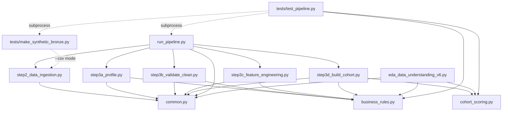
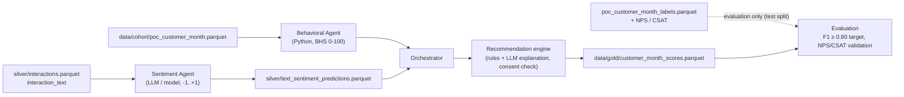

# flow.md — Execution Flow and End-to-End Pipeline

**Project:** Customer Health & Sentiment Scoring Multi-Agent AI Solution
**Grain:** one row per `customer_id × month` (Oct-2025 – Sep-2026) · **Stack:** Python 3.10+, DuckDB, pandas

---

## 1. End-to-end pipeline at a glance

```mermaid
flowchart LR
    RAW["data/raw/*.csv<br/>customers · transactions<br/>engagements · interactions"]
    S2["Step 2<br/>step2_data_ingestion.py"]
    BR["data/bronze/*.parquet"]
    EDA["EDA (analysis only)<br/>eda_data_understanding_v6.py"]
    RULES[["business_rules.py<br/>mappings · ranges · CORE_RULE"]]
    S3A["Step 3a<br/>step3a_profile.py"]
    GATE{{"Human gate<br/>config/allowed_values.json"}}
    S3B["Step 3b<br/>step3b_validate_clean.py"]
    SIL["data/silver/*.parquet"]
    Q["data/quarantine/*.parquet"]
    S3C["Step 3c<br/>step3c_feature_engineering.py"]
    FEAT["data/features/<br/>customer_month_features.parquet<br/>customer_month_labels.parquet"]
    S3D["Step 3d<br/>step3d_build_cohort.py"]
    COH["data/cohort/<br/>poc_customer_month.parquet<br/>poc_customer_month_labels.parquet<br/>poc_customers.parquet"]
    NEXT["Step 4 (next)<br/>Agents: Behavioral · Sentiment<br/>Recommendation · Orchestrator"]

    RAW --> S2 --> BR
    BR --> EDA -. "evidence to set / confirm" .-> RULES
    BR --> S3A --> GATE --> S3B
    S3B --> SIL
    S3B --> Q
    SIL --> S3C --> FEAT --> S3D --> COH --> NEXT
    RULES --> S3A & S3B & S3C & S3D
```



**Recommended order of execution**

| Order | Run | Purpose | Mandatory |
|---|---|---|---|
| 1 | `python step2_data_ingestion.py` | Raw CSV → Bronze Parquet | Yes |
| 2 | `python eda_data_understanding_v6.py` | Understand the data; confirm mappings, ranges and `CORE_RULE` in `business_rules.py` | Yes (first time / when data changes) |
| 3 | `python step3a_profile.py` | Profile Bronze; write `config/allowed_values_suggested.json` | Yes |
| 4 | **Human gate:** review and save as `config/allowed_values.json` | Freeze the allowed categories | Strongly recommended |
| 5 | `python run_pipeline.py --from 3b` | 3b → 3c → 3d | Yes |

Or in one go, once the gate file exists: `python run_pipeline.py` (2 → 3a → 3b → 3c → 3d).

---

## 2. Folder layout

```text
project/                          <- PIPELINE_ROOT (default: folder containing common.py)
├── common.py  business_rules.py  cohort_scoring.py
├── step2_data_ingestion.py  step3a_profile.py  step3b_validate_clean.py
├── step3c_feature_engineering.py  step3d_build_cohort.py  run_pipeline.py
├── eda_data_understanding_v6.py
├── *.ipynb                       <- same code, one cell per section (keep next to the .py files)
├── pytest.ini
├── tests/  make_synthetic_bronze.py  test_pipeline.py
├── config/   allowed_values_suggested.json · allowed_values.json · cohort_selection.json (optional)
├── data/
│   ├── raw/ bronze/ silver/ quarantine/ features/ cohort/
│   ├── eda/                      <- EDA artefacts only (never read by production)
│   ├── gold/                     <- reserved for production scores (Step 4)
│   └── customer_scoring.duckdb
├── reports/  profile/ dq/ features/ cohort/ eda/
└── logs/     ingestion audit + rejected CSV rows
```

> If your scripts are in `src\` and your data is one level up, set `PIPELINE_ROOT` to the folder that **contains** `data\` (PowerShell: `$env:PIPELINE_ROOT = "C:\...\files"`). Every script, including Step 2 and the EDA, now honours it.

---

## 3. How the files depend on each other



| Shared module | Role | Used by |
|---|---|---|
| `common.py` | Paths, window, column catalogue, DuckDB connection, I/O helpers, check printing, `finish()` | All steps, runner, EDA |
| `business_rules.py` | **Single source of truth**: category mappings, survey scales, DQ `RANGES`, `CORE_RULE`, cohort weights, SQL builders (`isin`, `core_source_sql`, `history_sql`, `tenure_band_sql`) | 3a, 3b, 3c, 3d, EDA, tests |
| `cohort_scoring.py` | Pure-pandas scorecard maths: `max_mom_swing`, `score_candidates` | 3d, EDA Steps 12 / 12A, tests |

---

## 4. Step-by-step: functions called, from where, and data in / out

Notation: `module.function()` ← caller. Every step's `main()` is called either by `if __name__ == "__main__": finish(main())` (direct run) or by `run_pipeline.run()`.

### Step 2 — `step2_data_ingestion.py` (Raw → Bronze)

```text
main()
├── check_inputs()                         -> raises if any CSV missing in data/raw
├── common.get_connection()
├── for each source: ingest_file(con, name, cfg)
│   ├── check_header()                     -> CSV header must equal data-dictionary order
│   ├── build_read_csv()                   -> explicit schema, reject capture
│   └── COPY -> data/bronze/<t>.parquet ; rejects -> logs/rejects_<t>.csv
├── create_bronze_views()                  -> v_bronze_<t> views in customer_scoring.duckdb
└── print_summary()                        -> volume / PK checks = WARN (STRICT_VOLUMES=1 -> fail)
```

| In | Out |
|---|---|
| `data/raw/{customers,transactions,engagements,interactions}.csv` | `data/bronze/*.parquet` (+ `_source_file`, `_ingested_at`), `logs/ingestion_audit_*.json` |

### EDA — `eda_data_understanding_v6.py` (analysis only, run after Step 2)

Runs top to bottom as cells. Helpers (`q`, `save`, `flag`, `run_step`) are local; the connection comes from `common.get_connection(db_path=reports/eda/eda_work.duckdb)`.

```text
register_sources()                 Bronze -> raw_*, cust/cust1, tx, eng, itx typed views
step3a_category_mapping()          checks business_rules mappings vs data      -> s3a_*
step3a_channel_analysis()          channel Q1-Q5                               -> s3a_channel_*
build_cm()                         customer x month table cm (EDA spine)
build_cm_features()                fb_i, fb_m, eng_f, tx_f, cm_feat            -> data/eda/*.parquet
step1 … step10                     structure, quality, univariate, 3B refunds, time, coverage, lifecycle,
                                   7/7A-7F interactions & surveys, relationships, segments, leakage + funnel
Section 11 (build_scores, bhs_np)  BHS calibration, sensitivity, CSAT/NPS validation, out-of-time
step12_cohort()                    -> cohort_scoring.max_mom_swing / score_candidates   -> s12_*
step12a_core_rule_comparison()     re-runs step12 per CORE_RULE, agreement test         -> s12a_*
write_summary()                    reports/eda/eda_summary.md
```

**Interaction with production:** the EDA does **not** feed data to the pipeline. It produces the **evidence** used to confirm `business_rules.py`: mappings (3A), ranges (Step 2), `MIN_HISTORY_MONTHS` (Steps 6/10), and `CORE_RULE` (12A). Step 3d then applies the same rule through the same functions.

### Step 3a — `step3a_profile.py` (Bronze, read-only)

```text
main()
├── common.register_layer(con, BRONZE_DIR, "v_bronze")
├── overview() · schema_and_summary() · distinct_values() · time_coverage() · fk_coverage()
├── range_preview()               <- business_rules.RANGES (same limits 3b enforces)
├── per_customer_distribution() · label_profile() · samples()
└── writes config/allowed_values_suggested.json
```

| In | Out |
|---|---|
| `data/bronze/*.parquet` | `reports/profile/01…11_*.csv`, `config/allowed_values_suggested.json` |

### Step 3b — `step3b_validate_clean.py` (Bronze → Silver + Quarantine)

```text
main()
├── common.load_allowed_values()                   (config/allowed_values.json, optional)
├── common.register_layer(con, BRONZE_DIR, "v_bronze")
├── for t in [customers, interactions, transactions, engagements]:     customers first = FK target
│   └── clean_table(con, t, allowed)
│       ├── build_spec(con, t, allowed)            REJECT / FIX / WARN SQL using business_rules.RANGES, isin, sql_list
│       ├── flags()                                -> _dq_reject / _dq_fix / _dq_warn lists
│       ├── pass 1 (row rules) -> pass 2 (exact dup, duplicate PK, orphan FK vs silver_customers)
│       └── COPY -> silver/<t>.parquet  |  quarantine/<t>.parquet ; view silver_<t>
├── issue_counts()                                 -> reports/dq/dq_issue_counts.csv
└── post_checks(con)                               every check must be 0 violations
```

| In | Out |
|---|---|
| Bronze + optional `allowed_values.json` | `data/silver/*.parquet`, `data/quarantine/*.parquet`, `reports/dq/*` |

### Step 3c — `step3c_feature_engineering.py` (Silver → customer-month features)

```text
main(strict)
├── common.register_layer(con, SILVER_DIR, "silver")
├── check_mappings(con, strict)            business_rules values must exist in Silver (fees optional)
├── monthly_transactions(con)  -> m_txn    spend, payments, refunds, reversals, fees, currency (isin on business_rules)
├── monthly_engagements(con)   -> m_eng    positive / neutral / negative events, opt-outs, sessions
├── monthly_interactions(con)  -> m_int    complaints, open issues, repeat contact, FCR, CSAT, NPS  (no labels)
├── monthly_labels(con)        -> m_lbl    sentiment ground truth (separate file, evaluation only)
├── build_customer_month(con)  -> cm_base  dense spine from min(signup month, first event month), zero-fill counts
│                              -> cm_roll  *_3m rolling sums, prev-3m, months_observed, active_m, has_*_3m
├── final_features(con)        -> cm_features  ratios, trends, recency, coverage, ctx_* profile context
├── feature_qa(con)                        leakage, duplicates, ranges, "no event lost from spine"
└── COPY -> features/customer_month_features.parquet + customer_month_labels.parquet
```

| In | Out |
|---|---|
| `data/silver/*.parquet` | `data/features/customer_month_features.parquet` (model inputs, **full population**), `customer_month_labels.parquet` (evaluation only), `reports/features/*` |

### Step 3d — `step3d_build_cohort.py` (features → POC cohort) — **Task 1**

```text
main()
├── load_override()                        config/cohort_selection.json {core_rule?, dimension?, segment?}
├── cohort_conditions(rule)                <- business_rules.history_sql("active_m")
│                                             + business_rules.core_source_sql("has_txn_m","has_eng_m","has_int_m", rule)
├── register_inputs(con)                   feat, lbl views ; cust_attr (static segments, tenure_band) ; fc = feat ⋈ cust_attr
├── rule_sizes(con)                        core size under every CORE_RULE        -> cohort_rule_sizes.csv
├── build_scorecard(con, history, core)    per dimension/segment metrics + cohort_scoring.max_mom_swing()
├── cohort_scoring.score_candidates()      gated ranks, weights from business_rules.COHORT_WEIGHTS
├── choose_cohort(scored, override)        override, else top candidate passing MIN_COHORT_CUSTOMERS
├── build_cohort(con, chosen, core)        poc_customers (hash split train/test, customer-grouped) ; poc rows = core rows
├── validate(con, chosen, rule)            11 gate checks (history, sources, leakage, split, duplicates…)
├── representativeness(con, core)          cohort vs core population (SMD flags, informational)
└── writes cohort files ONLY if every gate check passes
```

**Cohort definition (same as EDA Steps 10 / 12):**

| Criterion | Rule |
|---|---|
| C1 | Silver customer with ≥ 1 event (Step 3c spine) |
| C2 | `active_m = 1` and `months_observed ≥ 3` |
| C3 | Same-month sources satisfy `CORE_RULE` (`tx_plus_one` by default; `any_two` if EDA 12A recommends it) |
| C4 | Customer belongs to the selected segment (static attribute) |
| Split | 80/20 **by customer** (all months of a customer in one split), seed 42 |
| Not required | CSAT / NPS presence (would bias toward survey responders) |

| In | Out |
|---|---|
| Features, labels, Silver customers, optional override | `data/cohort/poc_customer_month.parquet`, `poc_customer_month_labels.parquet`, `poc_customers.parquet`, `reports/cohort/*` (scorecard, rule sizes, validation, representativeness, coverage, `cohort_selection_used.json`) |

### Runner — `run_pipeline.py`

```text
main(argv) -> argparse (--from / --only / --lenient)
└── for step in [2, 3a, 3b, 3c, 3d][start:]:
        run(step) -> <step module>.main()      exception => printed, step FAILED
        stop at first FAILED and print "resume with --from <step>"
```

---

## 5. Data flow summary

| Layer | Location | Grain | Produced by | Read by |
|---|---|---|---|---|
| Raw | `data/raw/*.csv` | event / customer | source extract | Step 2 |
| Bronze | `data/bronze/*.parquet` | event / customer, as received + lineage | Step 2 | 3a, 3b, EDA |
| Silver | `data/silver/*.parquet` | cleaned event / customer + `_dq_fix`, `_dq_warn` | 3b | 3c, 3d (customers) |
| Quarantine | `data/quarantine/*.parquet` | rejected rows + `_dq_reject` | 3b | review only |
| Features | `data/features/customer_month_features.parquet` | customer × month, full population | 3c | 3d |
| Labels | `data/features/customer_month_labels.parquet` | customer × month (interaction months) | 3c | 3d → evaluation only |
| Cohort | `data/cohort/*.parquet` | customer × month (core rows of chosen segment) + split | 3d | Step 4 agents / modelling |
| EDA | `data/eda/*.parquet`, `reports/eda/*` | various | EDA | humans only |

**Guardrails carried through every layer**
- `sentiment_label`, `sentiment_score_gt` and `interaction_text` never enter the feature or cohort tables (checked in 3c and 3d).
- CSAT and NPS are never imputed: NULL means not observed.
- "No record" (`has_*_m = 0`) is kept distinct from "zero activity".
- Profile attributes are `ctx_*` context only and are never a penalty.
- Amounts stay in their native currency; cross-customer comparison uses within-(month, currency) percentiles.

---

## 6. Recommended next stage (Step 4, not built in this review)



The EDA's Section 11 (`build_scores`) is the calibration reference for the BHS weights and confidence, and it already reads `text_sentiment_predictions.parquet` when that file exists.

---

## 7. How to run

```powershell
# terminal (Windows PowerShell), from the project folder
python step2_data_ingestion.py
python eda_data_understanding_v6.py            # add --rebuild to refresh cm / cm_feat
python step3a_profile.py                       # then save config/allowed_values.json
python run_pipeline.py --from 3b               # 3b -> 3c -> 3d
python run_pipeline.py --only 3d               # rebuild the cohort only

# switch cohort rule without editing code
$env:CORE_RULE = "any_two"; python run_pipeline.py --only 3d

# tests (pip install pytest)
pytest -q tests/test_pipeline.py -m "not smoke"     # unit tests, seconds
pytest -q tests/test_pipeline.py                    # + end-to-end synthetic run (~25 s)
```

**Notebooks:** open the `.ipynb` next to its `.py` and choose Run All. Each notebook has the same code as its `.py` file, split into the same numbered sections. `run_pipeline.ipynb` runs from Step 3a by default (edit the list in its last cell).
